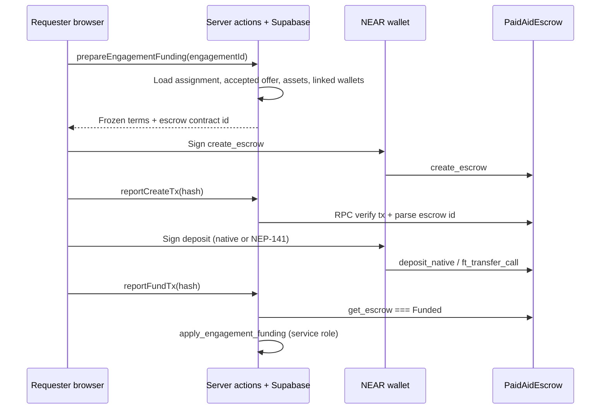

# V2 — Engagement funding (implementation plan)

## Verification of existing building blocks

| Layer | Verified state |
| --- | --- |
| **V1 accept → engagement** | `accept_response` atomically creates `assignments` + `engagements` (`active`). Agreed economics live on **`request_responses.proposed_amount` / `proposed_asset_id`** (not client-overridable at accept). |
| **Phase 1 wallet** | `linked_near_wallets` + NEP-413 link flow; Supabase identity is canonical; funding wallet must match linked account. |
| **Phase 2 assets** | `public.assets` with `chain_id`, `enabled`, native / NEP-141 metadata; balances for **linked** wallet only. |
| **Phase 3 escrow** | `PaidAidEscrow`: requester signs `create_escrow` + funding (`deposit_native` or `ft_transfer_call`); status `Funded` only after exact amount; sandbox deploy at `paidaid-escrow.sandbox`. |
| **Gaps today** | No payment columns on `engagements`; no escrow env in web; no provider wallet gate in product code (design **U4**); no on-chain verification path. |

Policy preserved: **no payout/refund UI**, no Supabase “funded” without RPC verification of `get_escrow`.

---

## Architecture



**Trust boundaries**

- Amount, asset, provider/requester NEAR accounts are computed **only on the server** from DB (`accepted_response` + `linked_near_wallets`).
- Client supplies **transaction hashes** only; server fetches outcomes from NEAR RPC and views `get_escrow`.
- `funded` status is written only via **`apply_engagement_funding_verified`** (service role), after server verification.

---

## On-chain flow

1. **`create_escrow`**: `engagement_id` = Supabase `engagements.id` (UUID string), `provider` = provider’s linked NEAR account, `amount` = `proposed_amount` smallest units, `asset` native or NEP-141 + `ft_contract` from `assets.token_contract_id`.
2. **`deposit_native`**: attached deposit **exactly** `amount` (yocto).
3. **NEP-141**: `ft_transfer_call` to escrow with `msg` `{"escrow_id":N}`; contract must allowlist FT (owner `add_allowed_ft` on deploy env).

Two wallet transactions (no contract change required): create, then fund. Optional later: single tx after a `get_next_id` view.

---

## Database (minimum)

**Table `engagement_escrow_payments`** (one row per engagement)

| Column | Purpose |
| --- | --- |
| `engagement_id` | FK, unique |
| `status` | `prepared` → `create_submitted` → `deposit_submitted` → `funded` \| `failed` |
| `chain_id`, `escrow_contract_id`, `network` | Chain context |
| `asset_id`, `amount` | Frozen from accepted response (`numeric(78,0)`) |
| `requester_*`, `provider_*` | Supabase user id + linked NEAR account at prepare time |
| `on_chain_escrow_id` | From create tx / `get_escrow` |
| `create_tx_hash`, `fund_tx_hash` | Explorer + idempotency |
| `last_error`, `funded_at`, timestamps | UX + audit |

**RLS**: requester and provider **select**; **no** direct client insert/update (mutations via RPC + service apply).

**RPCs**

| Function | Caller | Role |
| --- | --- | --- |
| `prepare_engagement_funding(engagement_id)` | authenticated | Validates eligibility; upserts `prepared` row with frozen terms |
| `apply_engagement_funding_verified(...)` | service_role | Sets `funded` after server verified on-chain state |

---

## Eligibility rules (`prepare`)

- Caller is **requester** on the engagement’s assignment.
- Engagement `status = active`.
- Payment row not already `funded`.
- Accepted response + asset row exists; asset `enabled`; `chain_id` matches `NEAR_NETWORK_ID`.
- Requester has active `linked_near_wallets`.
- Provider has active linked wallet (**U4 enforced for funding**).
- Linked wallet NEAR accounts valid for escrow args.

---

## Server modules

- `readEscrowNearConfig()` — escrow contract id from `NEAR_ESCROW_CONTRACT_ID` / public mirror; local default `paidaid-escrow.sandbox`.
- `@paidaid/near` — `parseEscrowIdFromCreateTx`, `fetchTransactionStatus`, `viewEscrow`, `assertEscrowFunded`.
- `engagement-funding-actions.ts` — `prepare`, `reportCreateTx`, `reportFundTx` (verify then service apply).

---

## Client UX (`engagement-funding-section.tsx`)

- Requester-only; shows **Awaiting funding** / **Funding…** / **Funded** / **Failed**.
- Displays agreed amount (remove “indicative” when funded).
- Preconditions: linked wallet; wallet account matches link; balance check via existing balance action (optional soft gate).
- Progress + explorer link when hash known.
- Wrapped in `NearSessionProvider`; does not alter delivery/chat workflow.

---

## Environment

```bash
NEAR_ESCROW_CONTRACT_ID=paidaid-escrow.sandbox
NEXT_PUBLIC_NEAR_ESCROW_CONTRACT_ID=paidaid-escrow.sandbox
```

Testnet: deploy escrow + allowlist USDC (or configured FT) separately.

---

## Tests

| Test | Layer |
| --- | --- |
| prepare rejects non-requester, funded, missing wallet | SQL or action unit |
| verify rejects wrong amount / wrong status on chain | `packages/near` |
| duplicate fund tx hash idempotent / safe | action |
| unauthorized report | action |
| happy path | optional integration with sandbox (`sandbox:test-escrow` pattern) |

---

## Out of scope (this phase)

- Payout, refund, payment history screens.
- Indexer (U1): server polls RPC at report time (acceptable MVP).
- Factory / JWT-gated `create_escrow` (U3): open create by requester wallet only; engagement UUID binding enforced off-chain + on-chain duplicate engagement id check.

## Implementation order

1. Migration + types  
2. `@paidaid/near` escrow verification helpers + shared escrow env  
3. Server actions + service apply  
4. Wallet send helpers + funding UI  
5. Tests + `docs/v2-engagement-funding.md` (operator notes)
