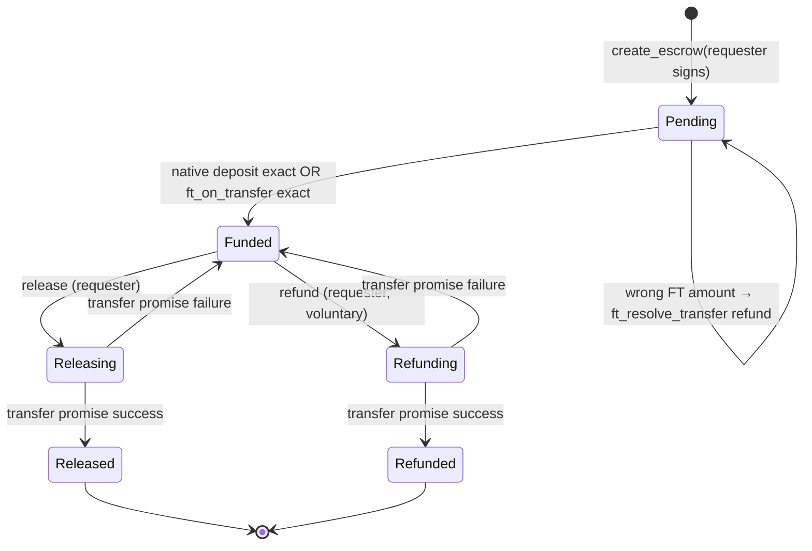

# V2 — PaidAid escrow contract (design & security)

## Inspection summary (current repo)

| Area | State |
| --- | --- |
| `contracts/core` | **PaidAidCore** only: per-account messages (`set_message`, views). **No funds.** |
| `near-sdk` | **5.30.0**, workspace `contracts/`, wasm `paidaid_core.wasm` |
| Deploy | `scripts/sandbox/deploy.mjs` → `paidaid.sandbox` on local RPC `3030` |
| Web `/contract` | Demo targets **PaidAidCore** via `NEXT_PUBLIC_NEAR_CONTRACT_ID` |
| Supabase engagements | UUID `engagements.id`; settlement today is **off-chain** (delivery approve / 72h auto-complete). **No cancellation RPC.** `engagement_issues` blocks auto-complete only. |
| Assets DB | `public.assets` registry (native / NEP-141 metadata for budgets); **not** on-chain allowlist yet |

**Preservation:** PaidAidCore and `/contract` remain unchanged. Escrow ships as a **second crate** (`contracts/escrow` → `paidaid_escrow.wasm`), deployed to a separate account (e.g. `paidaid-escrow.sandbox`; sandbox allows one-level subaccounts under `sandbox`).

---

## Escrow state machine



Terminal states **`Released`** and **`Refunded`** are irreversible (no double payout).

---

## On-chain record (per escrow)

| Field | Notes |
| --- | --- |
| `engagement_id` | Opaque string (Supabase UUID); validated non-empty, max 64 chars, charset |
| `requester` | NEAR account at `create_escrow` (signer) |
| `provider` | NEAR account bound at creation |
| `asset` | `Native` or `Nep141 { contract_id }` |
| `amount` | Exact smallest units (`u128`); **zero rejected** |
| `deposited` | Set when funding completes; must equal `amount` |
| `status` | `Pending` → `Funded` → terminal or intermediate payout states |

**Trust boundary:** The contract does **not** read Supabase. It only stores the engagement id string parties agreed to at creation. Marketplace orchestration (matching UUID, funded/settled flags) is a **later phase** and must not be spoofable from the web app alone.

---

## Asset support

- **Native:** requester calls `deposit_native(escrow_id)` with **exact** attached deposit while `Pending`.
- **NEP-141:** requester `ft_transfer_call` to escrow with message `{"escrow_id": <u64>}`; contract implements **NEP-141 receiver** (`ft_on_transfer`). Amount must match `amount`; otherwise **`ft_resolve_transfer` refund** to sender.
- **Allowlist:** Owner may `add_allowed_ft` / `remove_allowed_ft` only. **No owner pull of escrow balances.**
- **Native** does not need allowlist entry.

Decimals are **not** interpreted on-chain (smallest units only), matching `numeric(78,0)` / DB `assets.decimals` off-chain for display.

---

## Authorized transitions

| Action | Who | Preconditions |
| --- | --- | --- |
| `create_escrow` | Requester (signer) | Valid accounts, amount > 0, asset rules, FT on allowlist if NEP-141 |
| `deposit_native` | Requester | Escrow `Pending`, native asset, exact deposit |
| FT funding | Requester (token sender) | Same + allowlisted contract |
| `release` | **Requester only** | `Funded`, not already in payout |
| `refund` | **Requester only** | `Funded`, voluntary pre-release (see policy below) |

Provider **cannot** release or refund. Owner **cannot** move escrowed funds.

---

## Payout safety (promises)

- `release` / `refund` set status to **`Releasing` / `Refunding`** before external transfer.
- Native: `Promise::new` + `#[private]` callback on success sets **`Released` / `Refunded`**; on failure reverts to **`Funded`** with `deposited` unchanged.
- NEP-141: `ext_ft_transfer` with callback; same success/failure rules.
- **No** terminal state until callback confirms success → mitigates duplicate settlement and tracks failed payouts.

---

## Security assumptions

1. **Requester NEAR account** is willing to fund and later `release` (maps to marketplace requester wallet linking — off-chain product rule).
2. **Engagement UUID** is unique per escrow (`engagement_id` may map to at most one **non-terminal** escrow — enforced on create).
3. **FT contracts** on allowlist behave as NEP-141 (standard `ft_transfer` / `ft_transfer_call` / `ft_on_transfer` flow).
4. **No admin seizure** in this version.

---

## Policy decisions & blockers

### Resolved for this implementation

| Decision | Choice |
| --- | --- |
| Dispute / issue refund | **Not implemented.** No owner or arbiter refund while delivery is contested. |
| Voluntary refund | **Requester-only `refund` from `Funded`** (funds return to requester before `release`). Does not implement marketplace “cancellation” RPC; on-chain opt-out before payout only. |
| Disputed engagement | Escrow lifecycle is **independent** until orchestration exists; issues in Supabase do **not** trigger on-chain refund. |

### Unresolved (blocking marketplace orchestration, not blocking contract MVP)

| # | Topic | Needed before Supabase marks escrow funded/settled |
| --- | --- | --- |
| U1 | **Proof of funding** | Indexer or relayer observes chain events / tx status; app never trusts client-only “funded” flag. |
| U2 | **Release authorization** | Map `review_delivery(approve)` / auto-complete to requester **signed** `release` tx, or dedicated relay with session proof. |
| U3 | **Engagement ↔ escrow binding** | Who may call `create_escrow` for a UUID? Factory/relayer with Supabase JWT vs open create (spam risk). |
| U4 | **Provider NEAR account** | Require linked `provider` wallet before escrow create. |
| U5 | **Refund policy** | Product may forbid even voluntary on-chain refund; would remove `refund` in a follow-up. |
| U6 | **Cross-asset** | Escrow asset must match request budget asset from `public.assets`. |

### Explicit non-goals (this phase)

- Marketplace UI, payment orchestration, Supabase columns for settlement.
- Owner withdrawal, provider pull, dispute arbitration.
- Contract upgrade path (documented for future `migrate` / redeploy).

---

## Deployment (localnet)

```bash
pnpm sandbox:start
pnpm contract:build
pnpm sandbox:deploy          # PaidAidCore → paidaid.sandbox (unchanged)
pnpm sandbox:deploy-escrow   # PaidAidEscrow → paidaid-escrow.sandbox
```

---

## Interface (summary)

See [contracts/escrow/README.md](../contracts/escrow/README.md) for method list and FT message format.
