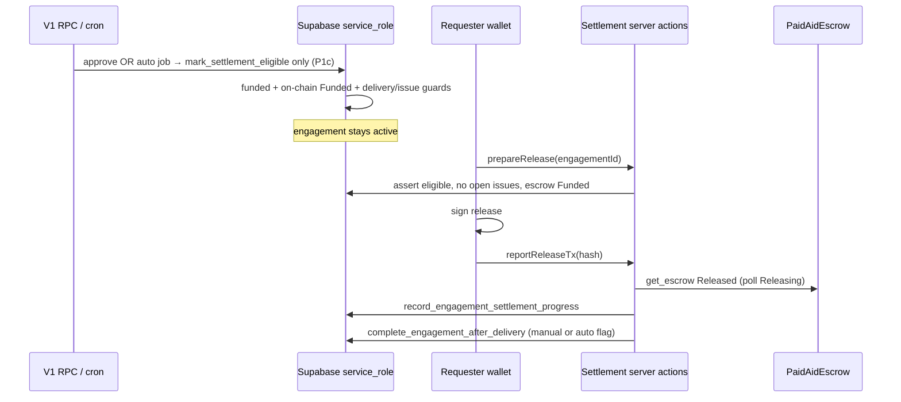

# V2 — Engagement settlement (plan & policy)

## Scope

Secure payout after **funded** escrow: manual approve, 72h auto-complete, revision/issue rules from V1, on-chain `release` + server verification. Refunds and platform fees are **design-only** until product decisions are confirmed.

---

## What exists today

| Layer | State |
| --- | --- |
| **V1 delivery** | `submit_delivery` → `pending_review` (+ 72h `auto_complete_deadline_at`). Requester `review_delivery(approve\|revision)`. `report_engagement_issue` / `resolve_engagement_issue`. |
| **V1 completion** | `complete_engagement_after_delivery` (shared by approve + `auto_complete_engagements` **service_role** only). **Open issues block all completion** (manual and auto). Revision clears deadline; resubmit restores 72h. |
| **V1 settlement copy** | UI still says “no payment settlement in V1”; completion does **not** touch `engagement_escrow_payments`. |
| **V2 funding** | DB through `funded`; wallet create/deposit; server verifies via `get_escrow`. |
| **On-chain payout** | `release` / `refund` (requester, `Funded` only), promise callbacks → `Released` / `Refunded`, idempotent terminals. **No app wiring.** |

**Code note:** `docs/v2-escrow-design.md` says issues block auto-complete only; **implementation blocks manual approve too** via `complete_engagement_after_delivery`. Settlement should follow **implementation**, not the stale doc line.

---

## V1 rules to preserve (settlement gates)

| Event | Escrow / settlement effect |
| --- | --- |
| Delivery submitted | No release; may fund escrow while `active`. |
| Revision requested | **No release**; deadline cleared (no auto-complete clock). |
| Open issue | **No** off-chain completion (hence no settlement eligibility via approve/auto paths). |
| Issue resolved | May restore 72h deadline if still `pending_review`. |
| Approve delivery | Completes engagement in Supabase today → should mark **settlement eligible** (manual). |
| Auto-complete job | Same completion when deadline due + guards → **settlement eligible** (auto). |

---

## NEAR constraint: auto payout vs 72h auto-complete

The escrow contract requires **`env::predecessor_account_id() == requester`** for `release`. The chain **cannot** move funds when a wall-clock passes unless:

1. The **requester signs** a `release` transaction (wallet, at or after eligibility), or  
2. The product adds **cryptographic pre-authorization** (e.g. delegate/meta-tx, function-call key scoped to `release`, or a **contract upgrade** with an on-chain proof verifier), or  
3. A **trusted relayer** is given on-chain authority (contradicts current “requester-only release” policy).

Therefore **72h auto-complete (Supabase) ≠ automatic on-chain transfer** under the current contract. Options:

| Mode | Off-chain | On-chain payout |
| --- | --- | --- |
| **A — Eligibility + requester sign** (recommended default) | `auto_complete_engagements` unchanged | Requester signs `release` after eligibility; cron **never** signs chain txs |
| **B — Pre-authorization at fund time** | Same | Extra wallet step stores delegate / signed intent; worker submits when eligible |
| **C — Contract oracle** | Service_role sets eligibility + HSM signs attestation; new `release_with_attestation` | True unattended payout; **new policy + contract change** |

**Rejected:** client-supplied timestamps, “release because UI says 72h”, or browser callbacks as authorization.

---

## Proposed settlement architecture (pending policy)

### Trust boundaries

- **Eligibility** (delivery approved path, auto-complete path, funded escrow, no open issues, not `revision_requested`, payment row `funded`, on-chain `Funded`): computed **only in Postgres** by `security definer` RPCs or **`service_role` batch jobs** — same trust as `auto_complete_engagements`.
- **Authorization to move funds:** always **requester-signed** `release` under current contract (unless product chooses B or C).
- **Truth for payout:** `get_escrow` status `Released` (+ optional tx hash); poll `Releasing` until terminal or revert to `Funded`.
- **Supabase settlement fields:** updated **only** via `record_engagement_settlement_progress` (**service_role**), after server NEAR verification (mirror funding pattern).

### Data model (sketch)

Extend `engagement_escrow_payments` (or companion table):

| Field | Purpose |
| --- | --- |
| `settlement_status` | `not_eligible` → `eligible` → `release_submitted` → `released` \| `release_failed` (+ `refunding`/`refunded` later) |
| `settlement_eligible_at` | When server marked eligible |
| `settlement_trigger` | `manual_approve` \| `auto_complete` |
| `release_tx_hash` | Requester-reported; idempotent |
| `released_at` | After on-chain verify |
| `settlement_last_error` | Failed tx / callback revert |

Optional: `engagement_settlement_events` audit table (append-only).

**Do not** add client updatable columns on `engagements` for “paid”.

### Server orchestration

**Auto-complete path (P2a):** replace direct completion in `auto_complete_engagements` with `mark_settlement_eligible(..., auto_complete)` + notification; completion runs **only inside** `reportReleaseTx` success handler (or service job polling `Released`).

**Idempotency:** duplicate `reportReleaseTx` with same hash; `Released` on-chain; only one terminal payout per escrow (contract + DB unique constraints).

### Contract changes (minimal vs fee / oracle)

**Phase 1 (no policy blockers):** use existing `release`; optional `get_active_escrow_id_for_engagement` already deployed on latest wasm.

**Phase 2 (fees — after confirmation):** configurable `platform_fee_bps`, `fee_recipient` (owner-set), split on `release`: `provider_amount = amount - fee` with **integer bps on u128**, explicit rounding (floor fee, remainder to provider), validation `fee_bps <= MAX_BPS`.

**Phase 3 (optional unattended auto):** only if product picks B or C above.

### Application deliverables (after decisions)

1. Migrations + `record_engagement_settlement_progress`
2. Hook eligibility into `review_delivery(approve)` and `auto_complete_engagements`
3. `@paidaid/near`: `assertEscrowReleased`, poll `Releasing`, `sendReleaseEscrowTransaction`
4. `engagement-settlement-actions.ts` + UI on engagement page (requester, funded + eligible)
5. Tests: approve, revision, issues, auto-complete eligibility, double release, failed callback, unauthorized paths
6. Sandbox + testnet runbooks

---

## Resolved product decisions (2025-11-07)

| ID | Choice | Implication |
| --- | --- | --- |
| **P1** | **P1c** — Complete in DB **only after** on-chain `Released` | Change `review_delivery(approve)` and auto job: **do not** call `complete_engagement_after_delivery` until settlement verified. Engagement stays `active` until payout. |
| **P2** | **P2a** — Eligibility + requester-signed `release`; cron never signs chain txs | `auto_complete_engagements` marks settlement eligible + notifies; 72h does **not** auto-transfer funds. |
| **P3** | **Defer refunds** | No refund UI / orchestration in settlement v1; on-chain `refund` remains unused in app. |
| **P4** | **0% fee now** | Add **disabled** fee config hooks in design (bps, recipient, rounding); no collection until enabled. |

### P1c — Required V1 workflow changes

| Step | Today | Settlement v1 |
| --- | --- | --- |
| Requester approves delivery | `complete_engagement_after_delivery(false)` immediately | Delivery → `approved`; payment → `eligible`; engagement stays **`active`**; prompt **Release payment** |
| 72h auto job | `complete_engagement_after_delivery(true)` | Mark **eligible** (`trigger = auto_complete`); notify requester; engagement stays **`active`** |
| After `release` verified | — | Service_role runs `complete_engagement_after_delivery` (manual vs auto flag from trigger); then reviews unlock |

**Guards unchanged:** revision → no approve path to eligible; open issues → no eligibility; funded on-chain + DB `funded` required for release UI.

**Unfunded engagements:** If never funded, approve/auto paths should either block with clear error or complete without escrow (product: gate approve on `funded` when escrow row exists — recommended).

### P2a — Auto-complete vs marketplace “completed”

Users may see **active** engagement past 72h until they sign release. Copy/notifications: “Auto-accepted delivery — release payment to provider to finish.”

---

## Open items (non-blocking)

- **P5:** Unfunded engagement at approve time — block vs complete without pay (recommend **block approve** when `engagement_escrow_payments` exists and not `funded`).
- **Fee enablement:** bps + treasury account when product turns on P4.
- **Refund spec:** separate doc before any refund UI.

---

## Explicit non-goals (this phase)

- General cancellation arbitration  
- Owner/dispute pull from escrow  
- Client-writable settlement flags  
- Hardcoded platform fee  

---

## Implementation status (2025-11-07)

| Layer | Status |
| --- | --- |
| Migration `20251107190000_engagement_settlement.sql` | Added |
| P1c `review_delivery` / auto job | Eligibility + delivery approved; completion after `released` |
| Server `engagement-settlement-actions.ts` | `reportEngagementReleaseTx` + service_role progress |
| UI `engagement-settlement-section.tsx` | Requester release; provider waiting state |
| Contract fee hooks | Not added (0% policy) |
| Refund UI | Deferred |

Apply migration: `pnpm db:reset` or run migration against local Supabase.

---

## References

- V1 RPCs: `supabase/migrations/20251106230000_phase7_delivery_issues_reviews.sql`
- Cron: `docs/phase7-auto-complete-cron.md`
- Escrow: `contracts/escrow/src/lib.rs`, `docs/v2-escrow-design.md`
- Funding pattern: `apps/web/app/(main)/engagements/engagement-funding-actions.ts`
